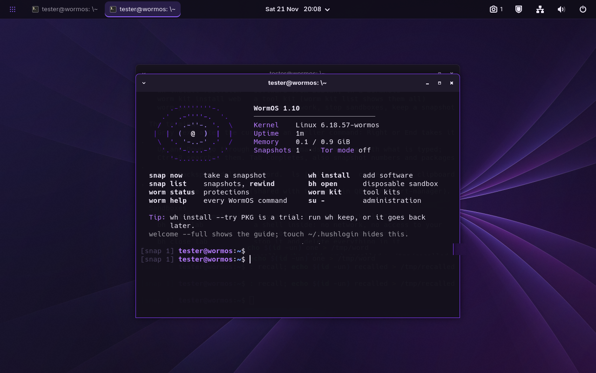
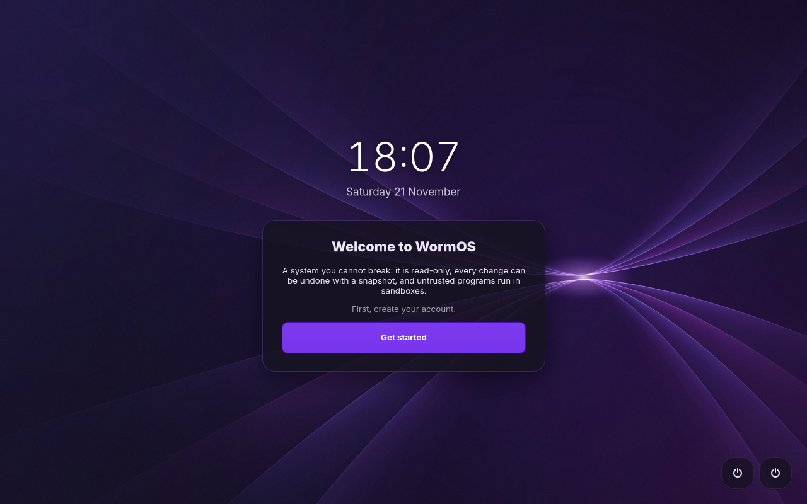
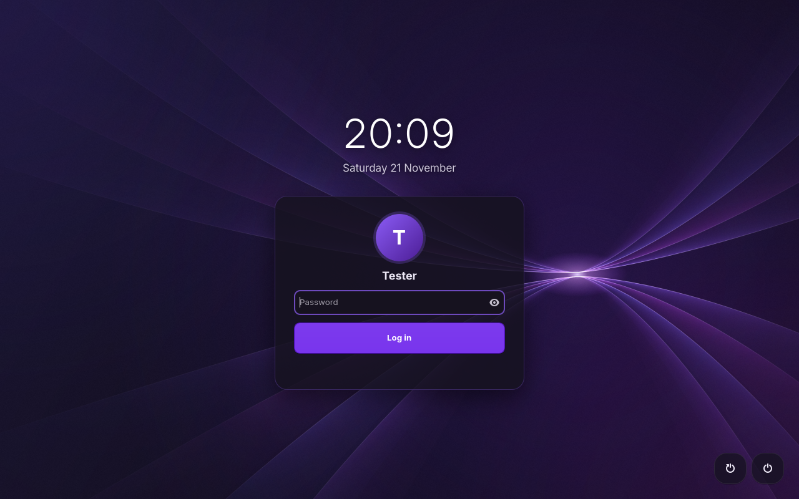
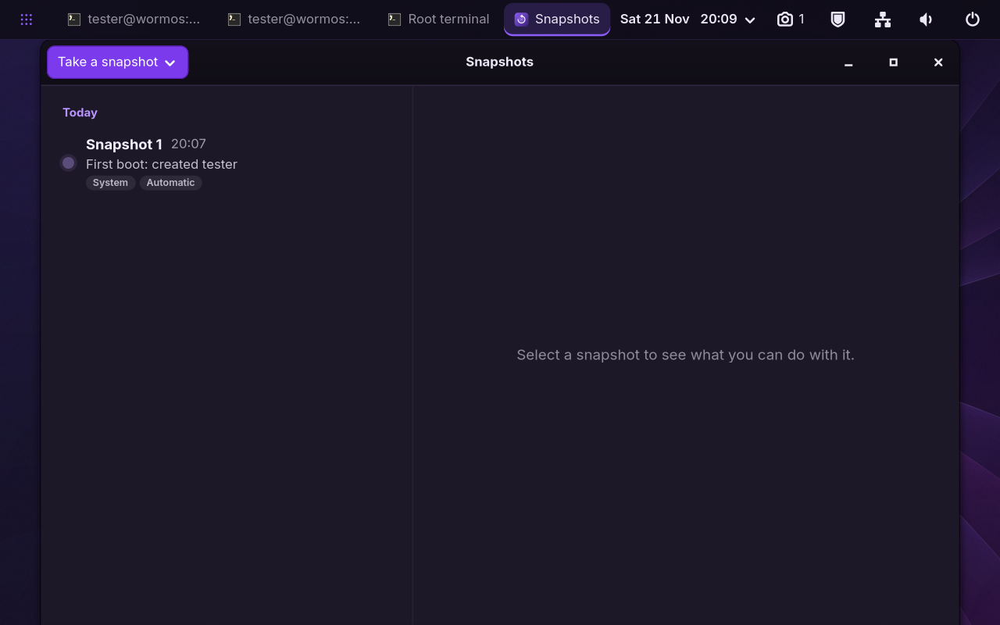

<div align="center">

# WormOS

**A Linux system you cannot break: read-only, snapshotted, sandboxed, with Tor built in.**

[](https://github.com/CrimsonMac/WormOS/actions/workflows/ci.yml)
[](https://github.com/CrimsonMac/WormOS/actions/workflows/release-tests.yml)
[](https://github.com/CrimsonMac/WormOS/releases/latest)
[](LICENSE)

[Download](https://github.com/CrimsonMac/WormOS/releases/latest) ·
[User guide](docs/guide.md) ·
[Building](docs/building.md) ·
[Internals](docs/internals.md) ·
[WormOS Amnesia](https://github.com/CrimsonMac/WormOS-Amnesia)



</div>

WormOS is an independent Linux operating system built from source: its own
init, package manager, snapshot tool, sandboxes, firewall frontend and
Wayland desktop shell, on a Linux kernel. The system is read-only and every
change can be undone, so it is a safe place to test software, write code or
take apart malware and go back one snapshot. Risky work runs in sandboxes
that cannot reach the host or its snapshots, and one command sends all
traffic through Tor. Four ideas run through all of it: **testing**,
**security**, **reversibility** and **isolation**.

## Highlights

- **Snapshots first.** Btrfs snapshots of the system and of `/home`, taken
  before every change, verified at boot, kept out of the running system's
  reach, and restorable from the command line, a graphical timeline or the
  boot menu.
- **Read-only and transactional.** The system is mounted read-only;
  `wh install` builds the change in a copy and switches to it, so an
  install either fully happens or does not happen. `wh undo` and
  `wh install --try` come for free, and upgrades download only the files
  that changed.
- **Easy to use.** A Welcome tour on first login, a Files window, a
  Software window that searches WormOS, Debian and Kali and installs
  without closing anything, update notifications, Settings for everything
  everyday, and every keyboard shortcut on Super+/. The terminal is there
  when you want it, not because you need it.
- **Blackholes.** Disposable sandboxes (namespaces, seccomp, Landlock, or a
  virtual machine with its own kernel) for untrusted programs and malware
  analysis, Windows binaries included.
- **Private by default.** A firewall that blocks everything inbound,
  encrypted DNS, random MAC addresses, no telemetry, and an anonymous mode
  that sends every connection of the machine through Tor. Tor Browser is
  preinstalled.
- **Packages from three worlds.** WormOS's own signed repository, plus
  Debian and Kali through *wormholes*: one container per distribution,
  with its programs appearing on the host like native ones. GTK, Qt, Java
  and X11 programs open on the desktop, get a launcher entry, open links
  and terminals, and ask for root through the root terminal, with no
  per-program fixes.
- **Tool kits.** Forensics, network analysis, blue team, reverse
  engineering, web testing, passwords and penetration testing, each one
  command away (`worm kit install forensics`, or `worm kit install all`).
- **Made for virtual machines.** WormOS finds the hypervisor at every
  start and applies base settings shipped for it (QEMU/KVM, VirtualBox,
  Hyper-V...): drawing, pointer, clipboard, disk tuning, the host's shared
  folders under `/media`, and its own guest agent, so virt-manager shows
  the IP address and shuts it down cleanly (`worm vm`).
- **Light and polished.** labwc with WormOS's own GTK 4 panel with quick
  settings, a launcher with quick actions, a Settings program,
  notifications, login screen and first-boot setup; about 130 MB of memory
  at idle.

## Screenshots

<table>
  <tr>
    <td></td>
    <td></td>
    <td></td>
  </tr>
  <tr>
    <td align="center">First-boot setup</td>
    <td align="center">Login screen</td>
    <td align="center">Snapshot timeline</td>
  </tr>
</table>

## Get WormOS

Download from the [release page](https://github.com/CrimsonMac/WormOS/releases/latest)
and check the files against `SHA256SUMS`.

| Edition | File | What you get |
|---|---|---|
| **WormOS** | `wormos-VERSION-x86_64.iso` | Live system and installer: everything, with Tor Browser and everyday tools |
| | `wormos-VERSION-x86_64.qcow2` | The same, installed, for QEMU and virt-manager |
| **WormOS Barebones** | `wormos-VERSION-barebones-x86_64.iso` | The operating system alone; `worm kit install basic` adds the tools |
| **[WormOS Amnesia](https://github.com/CrimsonMac/WormOS-Amnesia)** | its own releases | Live only, forgets everything, all traffic through Tor |

The ISO runs from memory and installs onto a disk of 8 GB or more (UEFI or
BIOS, Secure Boot off; 2 GB of memory or more). To try the disk image in
QEMU:

```sh
qemu-system-x86_64 -machine q35 -accel kvm -cpu host -m 2048 -smp 2 \
    -drive file=wormos-VERSION-x86_64.qcow2,if=virtio \
    -nic user,model=virtio-net-pci -device virtio-vga \
    -device virtio-keyboard-pci -device virtio-tablet-pci
```

The first start asks for your name and passwords. The
[user guide](docs/guide.md#trying-it) covers virt-manager, Windows hosts,
USB sticks and the installer.

## A quick tour

```sh
snap now -c "Before trying ngrep"   # snapshot the system
wh install --try ngrep              # install for a trial: wh keep, or it goes back
snap list                           # every snapshot, system and home
snap rewind                         # back to the last snapshot

wh install ffmpeg                   # from WormOS's signed repository
wh install --from debian gimp       # from Debian, through a wormhole

bh open lab                         # a disposable sandbox: no network, no files
bh open --vm lab                    # the same, with a kernel of its own

worm fw allow 22                    # open a port (everything else stays closed)
worm anon on                        # every connection through Tor
worm status                         # the state of every protection
worm panic                          # cut the network, stop sandboxes, snapshot
worm vm                             # the hypervisor found, its settings, host tips
```

`worm help` lists every command; the [user guide](docs/guide.md) explains
each feature and its limits.

## Documentation

| | |
|---|---|
| [User guide](docs/guide.md) | Editions, desktop, terminal, snapshots, packages, firewall, anonymous mode, Tor Browser, blackholes, tool kits |
| [Building and testing](docs/building.md) | Requirements, building from source, the test suites, CI, recipes |
| [Internals](docs/internals.md) | How the image, boot, snapshots, packages, wormholes and sandboxes work |
| [Legal](docs/legal.md) | Licenses, source code, trademarks, privacy |
| [Security policy](SECURITY.md) | Supported versions and how to report a vulnerability |

## Building from source

WormOS builds everything from source with its own cross toolchain. On a
Debian 13 machine with the packages listed in
[building.md](docs/building.md#requirements):

```sh
make          # toolchain, kernel, packages, signed repository, disk image
make run      # boot it in QEMU on the serial console
make test     # boot it and run the automated checks
```

The first build takes a couple of hours; later builds only rebuild what
changed.

## Roadmap

Done: a bootable base system, snapshots and the package manager, the
security baseline, the Wayland desktop and shell, tool kits, the live ISO
and installer, and the Barebones and Amnesia editions. Next: disk
encryption in the installer, Wi-Fi, a graphical sandbox mode
(`bh open --gui`) and Bluetooth.

## Contributing

Bug reports and ideas are welcome as
[issues](https://github.com/CrimsonMac/WormOS/issues/new/choose); please
include the WormOS version (`grep VERSION_ID /etc/os-release`) and what you
did. Pull requests should keep to the style of the code around them, update
the documentation when they change behaviour, and pass `scripts/lint.sh`,
`scripts/ci-build.sh` (both run by CI on every pull request) and
`make test`. Security problems go through [SECURITY.md](SECURITY.md), not
public issues.

## License

WormOS's own code is free software under the GNU General Public License,
version 3 or (at your option) any later version: see [LICENSE](LICENSE).
It is built from many other projects, each under its own license; their
texts are installed in `/usr/share/licenses`, and the complete source of
every package is published next to it in the
[package repository](https://github.com/CrimsonMac/wormos-packages/releases/tag/core).
See [docs/legal.md](docs/legal.md).

WormOS comes with **no warranty**. Its security features reduce risk; they
do not make running untrusted software safe, and no system is
impenetrable: the [user guide](docs/guide.md) states the limits of each.
